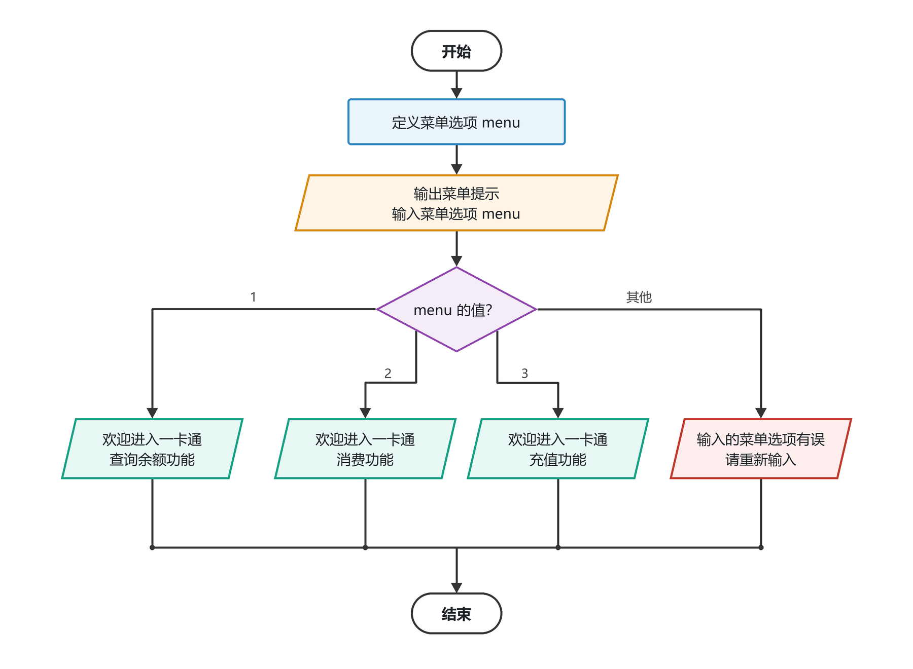
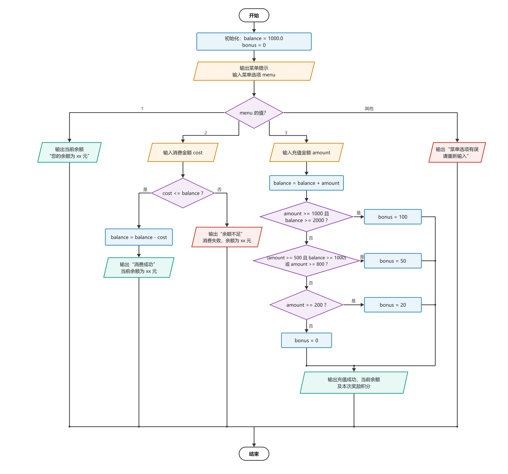

# 选择结构程序设计实验（2）

本目录完成实验指导书中“选择结构程序设计实验（2）”的两个编程任务，包含流程图、C 语言源代码和可执行文件。

## 文件说明

| 文件 | 说明 |
| --- | --- |
| `exp4-1.c` / `exp4-1.exe` | 任务 1：用 `switch` 实现一卡通菜单欢迎提示 |
| `exp4-2.c` / `exp4-2.exe` | 任务 2：在任务 1 基础上实现查询、消费、充值及积分奖励 |
| `exp4-1.png` | 任务 1 流程图 |
| `exp4-2.png` | 任务 2 流程图 |

## 任务 1：菜单欢迎提示

### 问题分析

1. 定义整型变量 `menu` 保存菜单选项。
2. 输出菜单说明，用 `scanf` 读取 `menu`。
3. 用 `switch(menu)` 分别处理 `case 1`、`case 2`、`case 3`，输出对应的欢迎信息。
4. 其他取值进入 `default`，提示菜单选项有误。

### 流程图



### 运行效果

| 输入 | 输出 |
| --- | --- |
| `1` | 欢迎进入一卡通查询余额功能 |
| `2` | 欢迎进入一卡通消费功能 |
| `3` | 欢迎进入一卡通充值功能 |
| 其他值 | 输入的菜单选项有误，请输入1、2或3！ |

## 任务 2：一卡通充值管理

### 问题分析

程序先初始化 `balance = 1000.0`，再根据 `menu` 进入不同分支：

- **菜单 1（查询余额）**：直接输出当前 `balance`。
- **菜单 2（消费）**：读取 `cost`，当 `cost <= balance` 时扣款并输出消费成功及余额；否则提示余额不足。
- **菜单 3（充值）**：读取 `amount`，先执行 `balance += amount`，再根据充值和累计余额判断积分奖励。
- **其他菜单**：进入 `default`，提示输入有误。

### 积分判断说明

按“充值到账后的累计余额”判断，条件顺序如下：

1. `amount >= 1000 && balance >= 2000`：奖励 100 积分；
2. `(amount >= 500 && balance >= 1000) || amount >= 800`：奖励 50 积分；
3. `amount >= 200`：奖励 20 积分；
4. 其他情况：不奖励积分。

条件 2 中同时使用了逻辑与、逻辑或，代码中用括号明确运算顺序，避免歧义。

### 流程图



### 测试记录

| 菜单 | 输入金额 | 结果 |
| --- | --- | --- |
| 1 | — | 余额 1000.00 元 |
| 2 | 300 | 消费成功，余额 700.00 元 |
| 2 | 1000 | 消费成功，余额 0.00 元 |
| 2 | 1200 | 余额不足，消费失败 |
| 3 | 1200 | 余额 2200.00 元，奖励 100 积分 |
| 3 | 800 | 余额 1800.00 元，奖励 50 积分 |
| 3 | 500 | 余额 1500.00 元，奖励 50 积分 |
| 3 | 300 | 余额 1300.00 元，奖励 20 积分 |
| 3 | 100 | 余额 1100.00 元，未达到奖励条件 |
| 4 | — | 菜单选项有误 |

## 编译与运行

源文件使用 GBK 编码和 CRLF 换行，可直接用 Dev-C++ 打开、编译和运行；也可使用 MinGW GCC：

```bash
gcc -std=c99 -Wall -Wextra -O2 -o exp4-1.exe exp4-1.c
gcc -std=c99 -Wall -Wextra -O2 -o exp4-2.exe exp4-2.c
```
