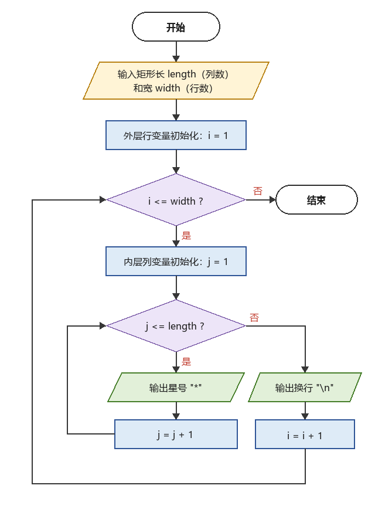
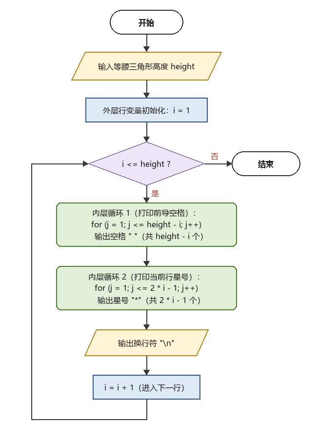
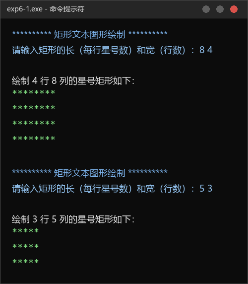
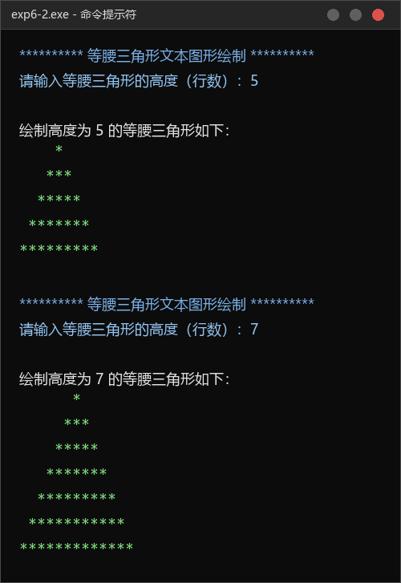

# 循环结构程序设计实验（2）

本目录完成《C语言程序设计》实验指导书中“循环结构程序设计实验（2）”的文本图形绘制任务（矩形绘制与等腰三角形绘制），
包含 C 语言源代码、可执行文件、算法流程图、运行截图和实验报告。

## 文件说明

| 文件 | 说明 |
| --- | --- |
| `exp4-2-1.c` | 任务（1）矩形绘制源程序（GBK 编码、CRLF 换行，可直接用 Dev-C++ 打开） |
| `exp4-2-1.exe` | `exp4-2-1.c` 编译生成的可执行文件 |
| `exp4-2-2.c` | 任务（2）等腰三角形绘制源程序（GBK 编码、CRLF 换行，可直接用 Dev-C++ 打开） |
| `exp4-2-2.exe` | `exp4-2-2.c` 编译生成的可执行文件 |
| `exp4-2-1.png` | 矩形绘制双重 `for` 循环算法流程图 |
| `exp4-2-2.png` | 等腰三角形绘制嵌套 `for` 循环算法流程图 |
| `exp4-2-run1-1.png` ~ `exp4-2-run1-2.png` | 矩形绘制运行截图（正常尺寸与边界/非法输入处理） |
| `exp4-2-run2-1.png` ~ `exp4-2-run2-2.png` | 等腰三角形绘制运行截图（正常高度与边界/非法输入处理） |
| `实验六-2026030503028-毛俊中.docx` | 按学院实验（训）报告模板填写的完整实验报告 |

## 任务要求

设计程序绘制由星号（`*`）构成的文本图形，每种图形的大小和形状由用户输入确定：

1. **矩形绘制**：使用双重 `for` 循环嵌套绘制矩形，外层循环控制行（`width`），内层循环控制列（`length`），循环迭代次数由用户输入的长和宽确定；
2. **等腰三角形绘制**：使用嵌套 `for` 循环绘制等腰三角形，外层循环根据高度（`height`）控制行数，内层循环根据当前行号分别控制前导空格数和每行星号数。

## 任务分析

### 1. 矩形打印分析

1. **变量设计**：`length` 存放矩形的长（每行星号数量/列数），`width` 存放矩形的宽（打印行数），`i` 为外层行循环控制变量，`j` 为内层列循环控制变量。
2. **循环结构**：
   - 单行打印 `length` 个星号：`for (j = 1; j <= length; j++) printf("*");`
   - 重复打印 `width` 行：将单行打印放入外层循环 `for (i = 1; i <= width; i++)` 中，并在每行内层循环结束后输出 `printf("\n");` 换行。

### 2. 等腰三角形打印分析

设等腰三角形高度为 $h$（即 `height`），当前行号为 $i$（$1 \le i \le h$）：

1. **每行星号数量推导**：
   - 第 $1$ 行：$1$ 个星号（$2 \times 1 - 1$）
   - 第 $i$ 行：$2i - 1$ 个星号
   - 第 $h$ 行（底边）：$2h - 1$ 个星号
2. **每行前导空格数量推导**：
   - 把等腰三角形看作由 `*` 和空格组成的矩形，列宽等于底边长度 $2h - 1$；
   - 第 $i$ 行的总空格数为 $(2h - 1) - (2i - 1) = 2h - 2i$；
   - 空格在星号左右对称各占一半，故星号前打印的前导空格数为 $\frac{2h - 2i}{2} = h - i$（即 `height - i`）。

### 流程图





### 关键代码

```c
/* 1. 矩形绘制：外层控制行 width，内层控制列 length */
for (i = 1; i <= width; i++) {
    for (j = 1; j <= length; j++) {
        printf("*");
    }
    printf("\n");
}

/* 2. 等腰三角形绘制：外层控制行 height，内层分别打印空格与星号 */
for (i = 1; i <= height; i++) {
    for (j = 1; j <= height - i; j++) {
        printf(" ");
    }
    for (j = 1; j <= 2 * i - 1; j++) {
        printf("*");
    }
    printf("\n");
}
```

## 测试记录

| 序号 | 测试程序/项目 | 输入数据 | 运行结果 |
| --- | --- | --- | --- |
| 1 | `exp4-2-1`（矩形绘制） | `8 4` | 正确绘制 4 行 8 列星号矩形（每行 8 个 `*`，共 4 行） |
| 2 | `exp4-2-1`（矩形绘制） | `5 3` | 正确绘制 3 行 5 列星号矩形（每行 5 个 `*`，共 3 行） |
| 3 | `exp4-2-1`（边界/非法值） | `6 0` / `-4 3` | 提示“输入的参数无效，矩形的长和宽均必须大于 0！” |
| 4 | `exp4-2-1`（非数字输入） | `abc` | 提示“输入有误，请输入两个整数！” |
| 5 | `exp4-2-2`（等腰三角形） | `5` | 正确绘制 5 行等腰三角形（星号依次为 1、3、5、7、9 个，前导空格依次为 4、3、2、1、0 个） |
| 6 | `exp4-2-2`（等腰三角形） | `7` | 正确绘制 7 行等腰三角形（底边 13 个 `*`，左右对称） |
| 7 | `exp4-2-2`（最小边界值） | `1` | 正确绘制 1 行等腰三角形（0 个前导空格，1 个 `*`） |
| 8 | `exp4-2-2`（非法输入） | `0` / `xyz` | 输入 `0` 提示高度必须大于 0；输入 `xyz` 提示请输入一个整数 |

## 编译与运行

```bash
gcc -std=c99 -Wall -Wextra -O2 -o exp4-2-1.exe exp4-2-1.c
gcc -std=c99 -Wall -Wextra -O2 -o exp4-2-2.exe exp4-2-2.c
```

在 Dev-C++ 中直接打开 `exp4-2-1.c` 或 `exp4-2-2.c`，按 F11（编译运行）即可。

## 运行效果







