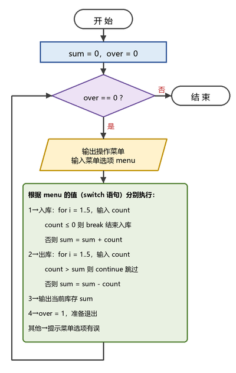
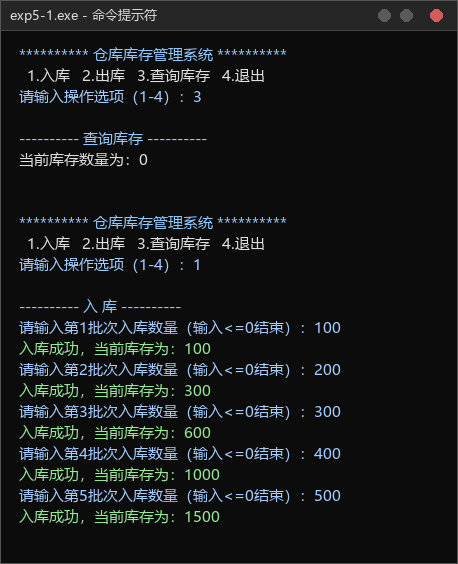
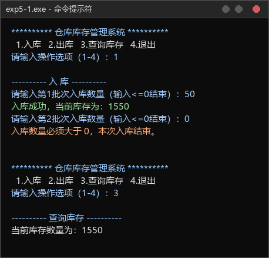
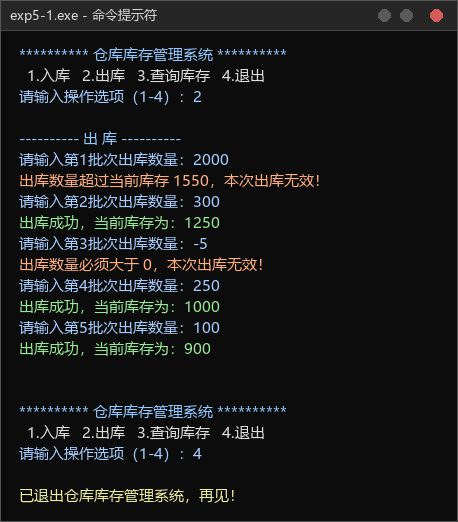
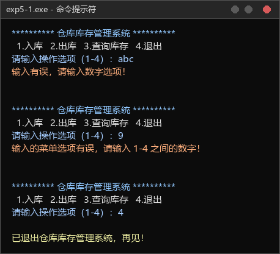

# 循环结构程序设计实验（1）

本目录完成《C 语言程序设计》实验指导书中“循环结构程序设计实验（1）”的仓库库存管理系统，
包含 C 语言源代码、可执行文件、主流程图、运行截图和实验报告。

## 文件说明

| 文件 | 说明 |
| --- | --- |
| `exp5-1.c` | 源程序（GBK 编码、CRLF 换行，可直接用 Dev-C++ 打开） |
| `exp5-1.exe` | MinGW gcc 4.9.2 编译生成的可执行文件 |
| `exp5-1.png` | 主流程图 |
| `exp5-run1-1.png` ~ `exp5-run1-3.png` | 正常流程运行截图（查询、入库、出库、退出） |
| `exp5-run2.png` | 非法输入处理运行截图 |
| `实验五-2026030503028-毛俊中.docx` | 按学院实验（训）报告模板填写的实验报告 |

## 任务要求

仓库库存管理系统：库存初始为 0，菜单 1 入库、2 出库、3 查询、4 退出。

1. 菜单构建：用 `while` 循环构建持续运行的主菜单；
2. 入库：用 `for` 循环连续处理 5 个批次，输入量小于等于 0 时用 `break` 结束入库；
3. 出库：用 `for` 循环连续处理 5 个批次，出库量大于当前库存时用 `continue` 跳过本次出库；
4. 查询：用 `printf` 输出当前库存；
5. 退出：用 `break` 跳出 `while` 循环，结束程序。

## 任务分析

1. **变量设计**：`menu` 菜单选项，`sum` 库存总量（初值 0），`count` 每批次入库/出库数量，
   `i` 批次计数，`over` 退出标志。
2. **主循环**：`while (!over)` 每轮输出菜单 → `scanf` 读入 `menu` → `switch (menu)` 分发。
3. **退出处理**：`switch` 内的 `break` 只跳出 `switch`，因此 `case 4` 中先把 `over` 置 1，
   再在 `switch` 之后用 `if (over) break;` 跳出 `while`。
4. **入库**：`for (i = 1; i <= 5; i++)`，`count <= 0` 时 `break` 终止入库，否则 `sum += count`。
5. **出库**：`count > sum` 或 `count <= 0` 时 `continue` 跳过该批次，否则 `sum -= count`。
6. **输入健壮性**：菜单项用 `scanf` 的返回值判断输入是否合法，非法时用 `getchar()` 清空缓冲区后重新显示菜单。

### 流程图



### 关键代码

```c
/* 入库：break 提前结束循环 */
for (i = 1; i <= 5; i++) {
    printf("请输入第%d批次入库数量（输入<=0结束）：", i);
    scanf("%d", &count);
    if (count <= 0) {
        printf("入库数量必须大于 0，本次入库结束。\n");
        break;              /* 结束入库的 for 循环 */
    }
    sum += count;
}

/* 出库：continue 跳过本次出库 */
for (i = 1; i <= 5; i++) {
    printf("请输入第%d批次出库数量：", i);
    scanf("%d", &count);
    if (count > sum) {
        printf("出库数量超过当前库存 %d，本次出库无效！\n", sum);
        continue;           /* 跳过本次出库，直接进入下一批次 */
    }
    sum -= count;
}
```

## 测试记录

| 序号 | 菜单/操作 | 输入数据 | 运行结果 |
| --- | --- | --- | --- |
| 1 | 3 查询 | — | 当前库存数量为：0 |
| 2 | 1 入库 | 100 200 300 400 500 | 每批次累加，库存由 0 变为 1500 |
| 3 | 1 入库 | 50 0 | 库存 1550 后输入 0，提示“入库数量必须大于 0，本次入库结束。” |
| 4 | 3 查询 | — | 当前库存数量为：1550 |
| 5 | 2 出库 | 2000 | 提示“出库数量超过当前库存 1550，本次出库无效！” |
| 6 | 2 出库 | 300 -5 250 100 | 库存依次变为 1250、1250、1000、900 |
| 7 | 菜单选项 | 9 | 提示“输入的菜单选项有误，请输入 1-4 之间的数字！” |
| 8 | 菜单选项 | abc | 提示“输入有误，请输入数字选项！” |
| 9 | 4 退出 | — | 提示“已退出仓库库存管理系统，再见！”，程序结束 |

## 编译与运行

```bash
gcc -std=c99 -Wall -Wextra -O2 -o exp5-1.exe exp5-1.c
```

在 Dev-C++ 中直接打开 `exp5-1.c`，按 F11（编译运行）即可。

## 运行效果








